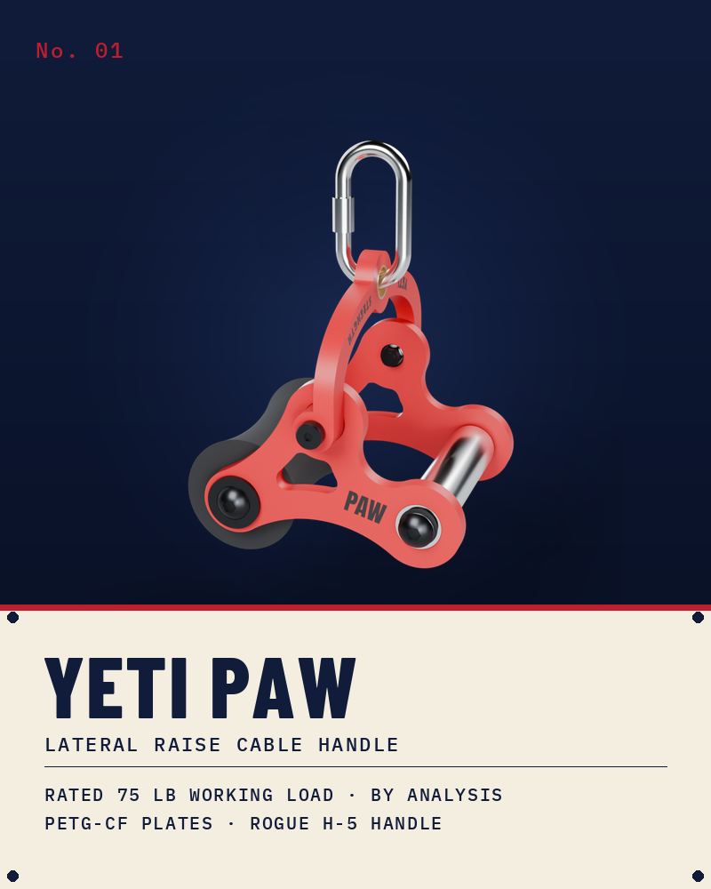
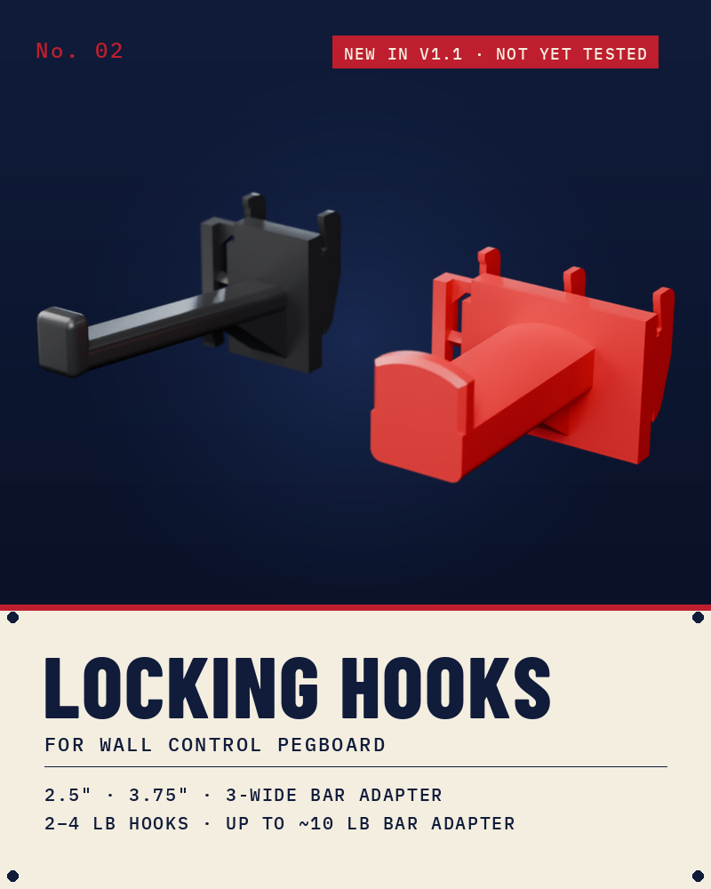
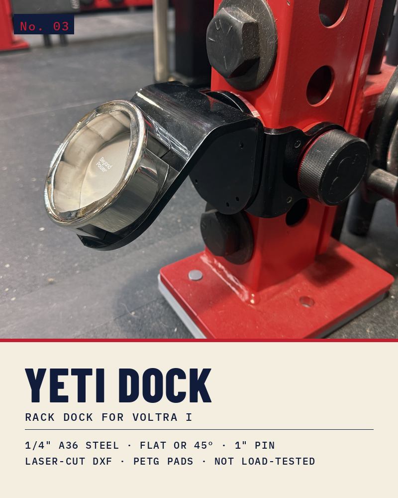

  

Printable gear for home gyms. The files are free, the loads are published, and every page says what has and hasn't been tested.

 

<table>
<tr>
<td width="50%" valign="top">

<h3><a href="https://github.com/Schnibbz/yeti-paw">YETI PAW</a></h3>
A lateral-raise cable handle. Hold it palm-down and the padded roller sits on your wrist. PETG-CF side plates, a Rogue handle on sealed bearings, and a swivel yoke that takes a carabiner.
  
Rated 75 lb working load by analysis, with the analysis published. Comes with Bambu projects, STL, STEP, CNC drawings for aluminum plates, a full bill of materials and assembly sheets.
</td>
<td width="50%" valign="top">

<h3><a href="https://github.com/Schnibbz/wall-control-hook">Locking Hooks for Wall Control</a></h3>
Hooks for Wall Control slotted pegboard that clip in and lock. No screws, and a bump won't knock them off.
  
Standard 2.5" for handles, straps and cable attachments. Long 3.75" for more gear on one hook. A 3-wide bar adapter for anything with a 2" barbell-sleeve hole, like row handles and landmine adapters. The long hook and the bar adapter are new in v1.1 and not tested yet.
</td>
</tr>
<tr>
<td width="50%" valign="top">

<h3><a href="https://github.com/Schnibbz/yeti-dock">YETI DOCK</a></h3>
A laser-cut ¼" steel bracket that hangs a VOLTRA I dock on a 3×3 rack upright with one 1" pin. Bolt the dock on flat, or add the 45° adapter to angle it out.
  
Order-ready DXFs, reference STEPs, PETG pads, and a drill-and-tap guide with the thread math. Calculated for the VOLTRA's 200 lb; not load-tested.
</td>
<td width="50%" valign="top">
</td>
</tr>
</table>

 

**Loads are worked out and published.** Every design is prototyped and fitted on real equipment, and anything new is marked untested on its page until it has been.

**Every project is ready to make.** Sliced Bambu files for the printed gear, order-ready DXFs for the steel, plus STL and STEP for anything else.

**Make it for yourself.** Share it and remix it with credit. Don't sell it. CC BY-NC-SA 4.0 unless the repo says otherwise.

 

  

