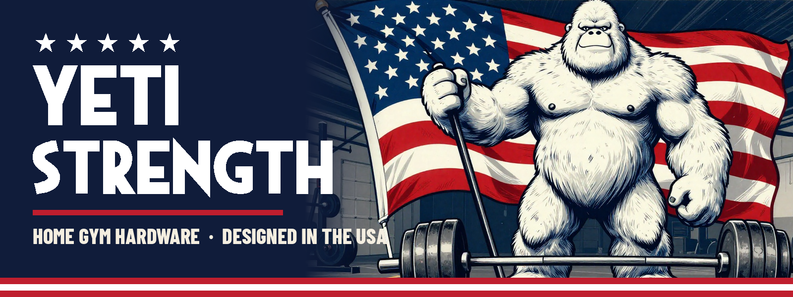

<h1 align="center">★ YETI STRENGTH ★</h1>

<b>Home gym hardware you can print, bolt on and lift with.</b> 
Designed in the USA by Schnibbz. Free files, real engineering, built for garage gyms.

---

## 🏋️ The gear

<table>
<tr>
<td width="50%" valign="top">

### [YETI PAW](https://github.com/Schnibbz/yeti-paw)
**Lateral-raise cable handle.** You hold it palm-down and the padded roller rests on your wrist. PETG-CF side plates, a Rogue handle on sealed bearings, and a swivel yoke for a carabiner.

- Rated **75 lb** working load, with the analysis published
- Bambu projects, STL, STEP, and CNC drawings for aluminium plates
- Full bill of materials and assembly sheets

**[→ Get the files](https://github.com/Schnibbz/yeti-paw)**
</td>
<td width="50%" valign="top">

### [Wall Control Locking Hooks](https://github.com/Schnibbz/wall-control-hook)
**Storage for your gym wall.** Plug-and-play hooks for Wall Control slotted pegboard that clip in and **lock**. No screws,
and they won't get knocked off.

- **Standard 2.5"** for handles, straps and cable attachments
- **Long 3.75"** 🆕 for more gear on one hook
- **3-Wide Bar Adapter** 🆕 for anything with a 2" barbell-sleeve hole (row handles, landmine adapters)

**[→ Get the files](https://github.com/Schnibbz/wall-control-hook)**
</td>
</tr>
</table>

---

## 🇺🇸 How it's built

- **Engineered, not guessed.** Loads are worked out and published. Designs are prototyped and fitted on real equipment, and
  new ones are marked 🆕 until they've been tested.
- **Print-ready.** Each project ships a sliced Bambu file you can print right away, plus STL for any other printer.
- **Free to make for yourself.** Share it, remix it, credit it. Don't sell it (CC BY-NC-SA unless the repo says otherwise).

<b>Lift heavy. Build your own. ★ YETI STRENGTH ★</b>

